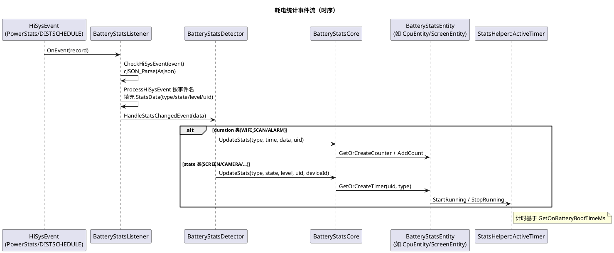

# 架构设计及约束

## 架构设计

### 设计原则

| 原则 | 描述 | 理由 |
|---|---|---|
| 事件订阅是唯一数据源 | 所有统计更新由 `BatteryStatsListener`（HiSysEvent）/`BatteryStatsSubscriber`（CommonEvent）事件驱动，业务侧禁止直接构造统计数据（AGENTS.md 架构不变量；实现见 `services/native/src/battery_stats_listener.cpp:49-89`） | 统计口径与各子系统实际状态强一致，避免多写入方导致数据漂移 |
| 累加型快照不可回滚 | `ActiveTimer`/`Counter` 只增不减（充满复位与 `Reset` 除外），查询返回重算后的快照（`utils/native/include/stats_helper.h:28-117`） | 耗电是物理过程的时间积分，回滚语义无业务意义 |
| `BatteryStatsCore` 是统计唯一入口 | 所有 `UpdateStats` 分发与计算经 Core 路由到实体；实体不感知事件来源（`services/native/src/battery_stats_core.cpp:280-322`） | 集中管理分发规则（屏幕/相机/连接性/通用），保证统计一致性 |
| 客户端零业务状态 | `BatteryStatsClient` 仅 IPC 转发 + 死亡通知自愈，无本地缓存（`frameworks/native/src/battery_stats_client.cpp`） | 状态集中在服务端，避免客户端与服务端数据不一致 |
| OnBattery 时间轴 | 计时基于 `GetOnBatteryBootTimeMs()`（电池供电单调时钟），`Counter::AddCount` 仅在 OnBattery 时累加（`stats_helper.h:93-104`） | 排除充电期间的使用，耗电归因只统计电池供电时段 |
| 权限服务端校验 | 查询/复位/SetOnBattery 均要求 `Permission::IsSystem()`，拒绝时经 `lastError_`→`tempError` 回传（`battery_stats_service.cpp:191-342`） | 客户端不可信；耗电数据属用户隐私 |
| 懒启动 | `run-on-create: false`，首次 IPC 才拉起服务（`sa_profile/3304.json`） | 降低开机开销，服务本体不做常驻采集 |

### 逻辑架构

自上而下四层（源码位置均相对仓根）：

1. **应用接口层**：ArkTS `frameworks/napi/src/battery_stats_module.cpp`（模块名 `batteryStatistics`，5 个查询接口 + `StatsType` 枚举）；taihe FFI 生成产物 `frameworks/ets/taihe/battery_stats/`；C++ inner_api `interfaces/inner_api/include/`（`battery_stats_client.h`、`battery_stats_info.h`、`battery_stats_errors.h`）。
2. **客户端 SDK 层**：`BatteryStatsClient`（`DelayedRefSingleton`），`Connect()` 经 samgr `GetSystemAbility(3304)` 取代理并挂 `BatteryStatsDeathRecipient`；连接失败置 `lastError_ = ERR_CONNECTION_FAIL`。
3. **IPC 层**：`services/IBatteryStats.idl` 定义 10 个方法（`GetBatteryStatsIpc/GetAppStatsMahIpc/GetAppStatsPercentIpc/GetPartStatsMahIpc/GetPartStatsPercentIpc/GetTotalTimeSecondIpc/GetTotalDataBytesIpc/ResetIpc/SetOnBatteryIpc/ShellDumpIpc`，`[ipccode 0]` 起编），`services/BUILD.gn` 的 `idl_gen_interface("batterystats_interface")` 生成 proxy/stub（`*_proxy.cpp`/`*_stub.cpp` 经 `filter_include` 分属 `batterystats_proxy`/`batterystats_stub` 两个 source_set）；`BatteryStatsService` 同时继承 `SystemAbility` 与 `BatteryStatsStub`。注意：AGENTS.md 描述的"手写 stub/proxy"已过时，以 IDL 现状为准。
4. **服务端层**（SA 3304，进程 `powermgr`）：
   - `BatteryStatsService`：生命周期与权限门控、依赖 SA 就绪监听、错误码暂存（`lastError_`）。
   - `BatteryStatsListener`（HiSysEventListener）：解析 PowerStats/DISTSCHEDULE 域事件 JSON 为 `StatsData`，按事件名分派 `Process*Event`。
   - `BatteryStatsSubscriber`（CommonEventSubscriber）：SHUTDOWN→保存、BATTERY_CHANGED→充满复位/OnBattery。
   - `BatteryStatsDetector`：`HandleStatsChangedEvent` 把 `StatsData` 按 duration/state 分类投给 Core，并聚合调试信息。
   - `BatteryStatsCore`：持有 15 个耗电实体，`UpdateStats` 分发、`ComputePower` 重算、Save/Load 持久化。
   - `BatteryStatsEntity` 族（`services/native/include/entities/`）：Uid/Cpu/Bluetooth/Idle/Phone/Screen/Wifi/User/Camera/Flashlight/Audio/Sensor/Gnss/Wakelock/Alarm 15 个实体。
   - `BatteryStatsParser`：解析 `power_average.json` 系数。
   - `BatteryStatsDumper`：HIDump。
   - 跨仓工具 `utils/native/`：`StatsHelper`（计时/计数/OnBattery 时钟）、`StatsUtils`（类型/状态枚举与常量）、`StatsHiSysEvent`（事件名常量）、`StatsXCollie`（看护）等。

查询与计算路径：`BatteryStatsService::GetBatteryStats`（权限校验）→ `ComputePower()`（XCollie 60s 看护 + `ResetStatsEntity` + 7 个实体 Calculate）→ `GetStatsInfoList` → IPC 返回 Parcelable 列表。

### 非功能设计

| 场景类别 | 方案设计 |
|---|---|
| 服务死亡自愈（客户端） | `BatteryStatsClient::Connect` 挂 `BatteryStatsDeathRecipient`；`OnRemoteDied` → `ResetProxy` 清空代理，下次调用自动重连（`frameworks/native/src/battery_stats_client.cpp:56-75`） |
| 懒启动时序补偿 | 服务晚于事件源启动：`OnStart` 监听 DFX 事件服务与 CES 上线后补做订阅；初值补偿：`Core::Init` 主动查 `BatterySrvClient::GetPluggedType` 设定 OnBattery，`LoadBatteryStatsData` 恢复上轮 Power 快照；`RegisterBootCompletedCallback` 置 `isBootCompleted_` 门控 Dump |
| 计算阻塞防护 | `ComputePower` 挂 `XCollie::SetTimer("BatteryStatsCoreComputePower", 60s, LOG)`；每个 IPC 入口构造 `StatsXCollie` 看护（`battery_stats_service.cpp:344-422`） |
| 并发安全 | 服务级 `mutex_` 串行化查询；Core `mutex_` 保护计算与 debugInfo；`UidEntity::uidEntityMutex_` 保护 uidPowerMap_；实体内部各自 mutex；静态 `statsInfoList_`/`totalPowerMah_` 仅在 ComputePower（ResetStatsEntity 后逐项 Update）与查询间受服务锁保护 |
| 双错误码协议 | IPC 返回值恒为 `ERR_OK`（送达语义），业务错误经 `tempError` 出参 + 客户端 `lastError_`/`GetLastError()` 查询（`battery_stats_service.cpp:344-359`） |
| 跨进程序列化 | `BatteryStatsInfo`/`ParcelableBatteryStatsList` 实现 `Marshalling/Unmarshalling`（`interfaces/inner_api/include/battery_stats_info.h:28-78`，IDL `sequenceable` 声明） |
| 部件可裁剪 | `batterystats.gni` 检测 bluetooth/wifi/display_manager/call_manager/config_policy 五个 part 输出 `HAS_BATTERYSTATS_*_PART` 宏，裁剪对应事件的解析代码（`battery_stats_listener.cpp` 顶部条件包含） |
| CFI/加固 | proxy/stub 与服务库启用 `sanitize = { cfi = true, cfi_cross_dso = true }`、`branch_protector_ret = pac_ret`（`services/BUILD.gn`） |

## 架构约束

- **统计数据只经事件写入**
  - **what**：所有 `UpdateStats` 只能由 `BatteryStatsDetector::HandleStatsChangedEvent`（事件链路）触发；业务代码禁止直接调用 Core/实体的 timer/counter 写方法（AGENTS.md 禁止事项）。
  - **why**：绕过事件源会破坏口径一致性，产生无法归因的耗电数据。
- **IPC ABI 契约不可破坏**
  - **what**：`services/IBatteryStats.idl` 的 `[ipccode N]` 只能追加；`BatteryStatsInfo` 的 Parcelable 字段顺序、`ConsumptionType` 枚举值、`*.map` 导出符号（`interfaces/inner_api/libbatterystats_client.map` 等）不可变更。
  - **why**：旧客户端按码值路由 IPC；序列化字段错位导致解析崩溃；thermal_manager 经 inner_kits 消费 `StatsType`/错误码。
- **懒启动不可翻转**
  - **what**：`sa_profile/3304.json` 的 `run-on-create: false` 不得改为 true（AGENTS.md 禁止事项）。
  - **why**：常驻启动会增加开机时长与常驻内存，且服务无周期任务，懒启动不损失功能。
- **耗电系数必须走配置**
  - **what**：禁止在代码中硬编码电流系数，必须经 `BatteryStatsParser` 读取 `power_average.json`；vendor 覆盖 system，配置策略优先。
  - **why**：系数与硬件强相关，硬编码导致所有产品共用错误值（AGENTS.md 禁止事项）。
- **powermgr 进程内禁止长耗时同步操作**
  - **what**：本进程与 SA 3301/3302/3303/3308 共享；`ComputePower` 内重算全量实体由 XCollie 看护，禁止在事件回调里做额外重活。
  - **why**：单 SA 阻塞拖死同进程全部系统服务（AGENTS.md 项目特定陷阱）。
- **统计复位只有三个合法入口**
  - **what**：充满电（`BATTERY_CHANGED` capacity==100，`battery_stats_subscriber.cpp:53-55`）、IPC `Reset`（系统权限）、`ResetStatsEntity`（每次 ComputePower 前清结果集，不清原始计时）。
  - **why**：随意的复位会破坏"一个放电周期的连续统计"业务语义。
- **持久化文件布局兼容**
  - **what**：`battery_stats.json` 的 Power/Hardware/Software 节键名固定，新增字段必须可被旧版本忽略。
  - **why**：跨版本升级后 Load 需能容忍旧文件（AGENTS.md 架构不变量）。
