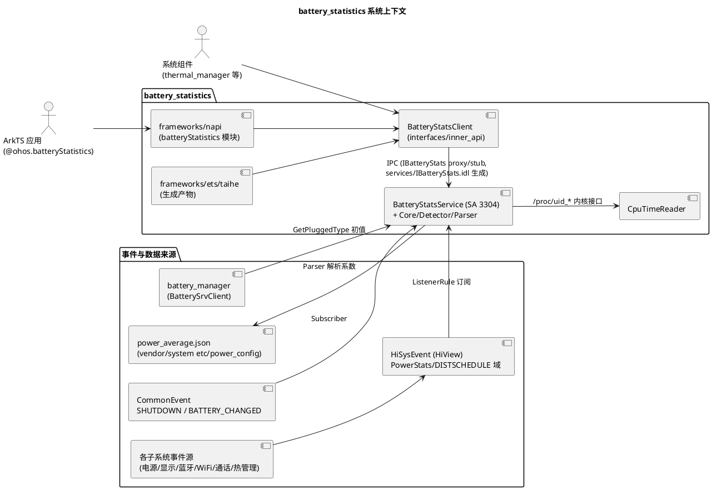

# 业务背景

## 应用定位

### 核心职责
battery_statistics（部件名 `@ohos/battery_statistics`，powermgr 子系统，系统能力 `SystemCapability.PowerManager.BatteryStatistics`）实现 OpenHarmony 耗电统计服务，SA ID 3304（`POWER_MANAGER_BATT_STATS_SERVICE_ID`），进程 `powermgr`，库 `libbatterystats_service.z.so`，`run-on-create: false`（懒启动，见 `sa_profile/3304.json`、`bundle.json`）。核心职责（`services/native/src/`）：

- **软件耗电统计**：按 Uid 统计每个应用的 CPU（active/cluster/speed）、相机、闪光灯、音频、传感器（重力/接近）、GNSS、蓝牙扫描、WiFi 扫描、唤醒锁、Alarm 等耗电，聚合成 `CONSUMPTION_TYPE_APP` 应用耗电。
- **硬件耗电统计**：统计蓝牙（BR/BLE on）、WiFi on、屏幕（亮屏/亮度分档）、通话（信号强度分档 radio_on/radio_data）、空闲（cpu_idle/suspend）、用户（多账户聚合）等硬件耗电。
- **耗电数据查询**：全量快照 `GetBatteryStats`、应用耗电 `GetAppStatsMah/GetAppStatsPercent`、硬件耗电 `GetPartStatsMah/GetPartStatsPercent`、活动时长 `GetTotalTimeSecond`、数据量 `GetTotalDataBytes`（`interfaces/inner_api/include/battery_stats_client.h`）。
- **统计生命周期管理**：基于电池供电（OnBattery）时间轴的计时/计数、充满电复位、关机时持久化到 `/data/service/el0/stats/battery_stats.json` 并在下次启动恢复。
- **供电状态维护**：依据电池插拔事件与 IPC `SetOnBattery` 维护"是否使用电池"全局态，计数仅在电池供电时累加。

### 职责边界（本组件不负责）
- **电池/充电状态采集与上报**：由 battery_manager（SA 3302）负责，本服务仅通过 `BatterySrvClient::GetPluggedType` 查询初值并订阅 `usual.event.BATTERY_CHANGED` 跟随变化。
- **电源动作与运行锁管理**：power_manager 负责；本服务只消费其 HiSysEvent（RUNNINGLOCK 等）作统计输入。
- **子系统事件的生产**：屏幕/亮度/相机/音频/传感器/蓝牙/WiFi/通话/热管理等事件由各子系统写入 HiSysEvent，本服务只订阅消费（`BatteryStatsListener`），不直接调用这些子系统接口。
- **耗电系数的定义**：各硬件/软件项的平均电流系数由产品配置 `power_average.json`（vendor/system 均可放置）决定，本服务只解析使用，不生成。
- **前台 UI 展示**：设置中的耗电排行由应用层基于本服务 API 开发；`frameworks/napi/` ArkTS 绑定与 `frameworks/ets/taihe/` 生成产物、`utils/native/` 跨仓工具按 AGENTS.md 划分属其他团队/生成物维护。
- **耗电治理动作**：本服务不执行省电策略（thermal_manager 等下游消费者基于本服务数据决策，`bundle.json` inner_kits 中 `utils:batterystats_utils` 可见性仅限 thermal_manager）。

## 系统上下文

数据流要点（均有代码依据）：
- **输入侧**：子系统状态变化 → HiSysEvent → `BatteryStatsListener::OnEvent`（`services/native/src/battery_stats_listener.cpp:49`）解析为 `StatsUtils::StatsData` → `BatteryStatsDetector::HandleStatsChangedEvent` 分类 → `BatteryStatsCore::UpdateStats` 更新对应实体的 ActiveTimer/Counter。
- **查询侧**：客户端 IPC → 服务端先 `ComputePower()` 重算（`services/native/src/battery_stats_service.cpp:191-270`），再从静态 `statsInfoList_` 返回。
- **持久化侧**：关机事件触发 `SaveBatteryStatsData`；下次启动 `BatteryStatsCore::Init` → `LoadBatteryStatsData` 恢复上轮耗电值。

## 核心输入

| 输入类别 | 来源 | 主要内容/参数 | 触发时机 |
|---|---|---|---|
| HiSysEvent | `HiviewDFX::HiSysEventManager::AddListener`（规则：域 "PowerStats" 全量 + "DISTSCHEDULE" 域的 START_REMOTE_ABILITY） | RUNNINGLOCK、SCREEN_STATE、BRIGHTNESS_NIT、BACKLIGHT_DISCOUNT、AMBIENT_LIGHT、CHANGED、POWER_TEMPERATURE、LEVEL_CHANGED、POWER_WORKSCHEDULER、WORK_*、TORCH_STATE、CAMERA_CONNECT/DISCONNECT、FLASHLIGHT_ON/OFF、STREAM_CHANGE、POWER_SENSOR_GRAVITY/PROXIMITY、GNSS_STATE、BR/BLE_SWITCH_STATE、BLE_SCAN_START/STOP、DISCOVERY_STATE、WIFI_CONNECTION、WIFI_SCAN、CALL_STATE、DATA_CONNECTION_STATE 等（`utils/native/include/stats_hisysevent.h:66-94`） | 各子系统状态变化时（`battery_stats_service.cpp:168-184`） |
| CommonEvent | `BatteryStatsSubscriber` | `usual.event.COMMON_EVENT_SHUTDOWN`（持久化触发）、`usual.event.BATTERY_CHANGED`（capacity/pluggedType 参数） | 关机、电池状态变化（`battery_stats_service.cpp:149-166`） |
| IPC 请求 | `IBatteryStats` stub（10 个方法，`services/IBatteryStats.idl`） | 查询/复位/SetOnBattery/ShellDump | 应用或系统组件调用（懒启动：首次调用拉起 SA） |
| 平均耗电配置 | `etc/power_config/power_average.json`（配置策略 `GetOneCfgFile` 解析；回退 vendor→system） | 各耗电项平均电流 mA（如 camera_on 810、wifi_on 83、screen_on 90），数组型：radio_on/radio_data 按信号分档、cpu_speed_cluster* 按频点、cpu_clusters 按簇 | 服务启动 `BatteryStatsParser::Init`（`services/native/src/battery_stats_parser.cpp:36-58`） |
| 内核 CPU 时间 | `/proc/uid_concurrent_active_time`、`/proc/uid_concurrent_policy_time`、`/proc/uid_time_in_state`、`/proc/uid_cputime/show_uid_stat` | 每 Uid 的 active/cluster/freq/总 CPU 时间 | `CpuTimeReader::Init/UpdateCpuTime`（`services/native/src/cpu_time_reader.cpp:29-32`） |
| 电池插拔初值 | `BatterySrvClient::GetPluggedType()` | pluggedType → 初始 OnBattery 状态 | `BatteryStatsCore::Init`（`battery_stats_core.cpp:132-138`） |
| 系统能力上线事件 | `OnAddSystemAbility`（DFX_SYS_EVENT_SERVICE_ABILITY_ID、COMMON_EVENT_SERVICE_ID） | SA ID | 依赖 SA 就绪时补做事件订阅（`battery_stats_service.cpp:113-122`） |

## 核心输出

| 输出类别 | 接收方 | 业务作用 |
|---|---|---|
| IPC 查询应答 | 客户端进程 | `BatteryStatsInfoList`（Parcelable 列表：uid/userId/consumptionType/power mAh）、应用/硬件耗电 mAh 与百分比、总时长（秒）、总数据量；权限拒绝时返回默认值并经 `tempError` 出参带回 `StatsError` |
| 耗电排行数据 | ArkTS 应用（`@ohos.batteryStatistics` 的 `getBatteryStats/getAppPowerValue/getAppPowerPercent/getHardwareUnitPowerValue/getHardwareUnitPowerPercent`，`frameworks/napi/src/battery_stats_module.cpp:136-150`） | 设置界面耗电排行、应用耗电占比 |
| 统计原始值 | 系统组件（thermal_manager 等经 `utils:batterystats_utils` 与 inner_api） | 温控/省电策略的用电画像输入 |
| 持久化文件 | `/data/service/el0/stats/battery_stats.json` | 跨开关机的 Power/Hardware/Software 三节耗电快照（`battery_stats_core.cpp:57`） |
| HIDump 输出 | `hidumper -s 3304` 使用者 | `-batterystats` 全量统计、`-poweraverage` 系数配置、`-h` 帮助（`services/native/src/battery_stats_dumper.cpp:29-68`） |
| DFX 观测 | HiView/日志 | 每次统计更新与计算的 `STATS_HILOGD/I` 日志、XCollie 看护（ComputePower 60s 定时器）、`batterystats.yaml` 事件定义 |
